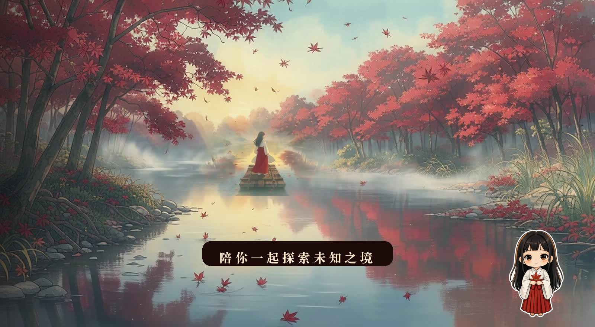

# 桔梗主题 · DSH Desktop

> 给 **DeepSeek Harness** 桌面版做的一层和风皮肤：**AI 生成的桔梗动画、动态壁纸、Q 版小桔梗、入场字幕配以原版日文旁白**，全部在本机渲染，不联网、不传数据、不依赖任何外部服务。

  -blue)

---

## 这是什么

DSH Desktop 的界面是通过 **Web 插件**（`webserver/index-inject` + exact 路由）改造的。这个仓库就是这样一个插件：它把默认的白底界面换成一套「枫叶、暮色、桔梗」的和风皮肤，并在启动时播一段十几秒的开机动画。

所有画面都由本机模型生成（ComfyUI 跑 FLUX 3 / HunyuanVideo 1.5 / Wan2.2），音频由本地零样本克隆 TTS 合成（IndexTTS-2.5）。**仓库里不放这些大文件**，见 [素材政策](#素材政策必读)。

## 长什么样

| 开机动画 | 主界面 |
|---|---|
|  |  |

| 壁纸（无 UI） |
|---|
|  |

> 这三张是作者的实机效果图（由动画帧合成，非渲染器截图）。想换成你自己的，替换 `docs/preview/` 下的同名文件即可。

## 特性

**画面**

- **开机**：AI 图生视频（HunyuanVideo 1.5，1280×704 / 49 帧 / 14 步，约 9 分钟一条），正放 + 倒放拼成 10.58 秒的 ping-pong 循环 —— 循环点就是一次普通帧步，因此看不到跳帧。
- **壁纸**：同一段素材做 2.6× 慢放并放到 1920×1056；也可以用 `?kkstill=1` 切到「静态帧 + 90 秒极慢推镜」，零解码、零 JS。
- **页内层**：Q 版小桔梗（呼吸 + 摇摆两套不同周期叠加，避免机械感）、入场字幕（楷体、字距 0.24em、两端渐变细线）、原版日文旁白（本地克隆音色，5 秒）、细雪（纯 CSS）、切入主界面的光带与火星。
- **壁纸不是 canvas 重绘的视频**：用原生 `<video>` + CSS `filter`，避免「每帧重画」和视频解码不同步导致的抽帧。

**工程**

- 16 条 exact 路由（`/dsh-kikyo/*`）+ 1 段注入脚本，全部由插件自己提供，`Cmd+R` 即生效。
- **性能预算写在代码里**：DPR 上限 1.5（省 44% 像素）、默认关闭二级粒子画布、壁纸模式不画逐帧噪点。
- **三层安全网**：纯 CSS 定时自撤（8.4 秒起淡出 + 14 秒兜底）、JS 13.5 秒硬兜底、`kikyo-off` 开关文件一键停用。

## 安全设计（比好看重要）

这套东西是挂在界面最顶层的，所以任何一层卡住都会表现成「应用打不开」。为此做了硬约束：

1. **绝不挂常驻 `MutationObserver`**。聊天 DOM 一直在变，观察者会饿死渲染器 —— 这是本项目踩过最惨的坑，直接在页面上留下引以为戒的注释。
2. **所有遮罩必须有纯 CSS 定时自撤**，不依赖 JS 有没有跑起来。
3. **装/改插件后必须 Cmd+Q 完全退出重开**；只改样式 `Cmd+R` 就够。
4. **主题让位于可用性**：出问题先 `tools/toggle.sh off`，再排查。

## 目录

```
plugin/                主题插件本体（可直接装）
  index.js             宿主：注入脚本/样式 + 16 条 exact 路由
  cordis.patch.yml     bundle 挂载声明（缺了 insert 行就完全不加载，且不报错）
  runtime/art.js       原画/视频 + 推镜 + 飘叶金尘（开机与壁纸共用）
  runtime/kikyo.js     开机时间轴、壁纸循环、Q 版与雪花
  runtime/kikyo.css    token、开机层、壁纸层、字幕、动效
  assets/              素材（仓库里默认不提交，见素材政策）
host/                  桌面壳开屏三件套 + 原始备份（危险区，可回滚）
tools/                 install / verify / toggle / rollback 四个脚本
docs/                  架构说明、素材生成说明、发布文案
```

## 安装

前置：macOS + DSH Desktop（Harness 在 `127.0.0.1:43129`）。

```bash
git clone <this-repo> && cd dsh-kikyo-theme-kit
bash tools/install.sh          # 同步插件（+ 可选的开屏资源）
bash tools/verify.sh           # 自检：文件 / 挂载声明 / 服务 / 路由
```

然后 **Cmd+Q 完全退出 DSH 再打开**。开机动画每次启动播一次，想强制重播在地址后加 `?kkboot=1`。

不想装了？`bash tools/toggle.sh off` 一个开关文件就能让插件在 `apply()` 入口直接 return，界面回到原生样式，不用删代码。

## 素材政策（必读）

- **代码、脚本、文档**：MIT，随便用。
- **图片、视频、音频、字体、角色 IP**：**不在授权范围内，也不要提交到仓库**。这个主题的原画来自作者本机用 FLUX 3 生成的图（其中部分参考了网络上的同人图），音乐来自犬夜叉 OST，角色版权属于原作者 —— 这些都不能随仓库分发。
- 想在自己机器上复现视觉效果：按 [docs/ASSETS.md](docs/ASSETS.md) 用你自己的语料/提示词重新生成，或把你**有授权**的图放进 `plugin/assets/`。
- 仓库默认 `.gitignore` 掉 `assets/*.{jpg,png,mp4,m4a}`、`art-web/`、`art-originals/`、`host/*.{mp4,jpg}`。

## 已知问题 / 想请你帮忙的地方

这些是我卡住的地方，任何一个都欢迎开 issue 或 PR：

1. **循环视频必然有一个"反向点"**。ping-pong 把跳点从"首尾拼接"挪到了"中段反向"，慢速平移尚可，但水波/雾气会整体反向。有更好的长循环方案（帧预测、光流重定时、或干脆语义级的循环生成）欢迎给思路。
2. **Q 版动效是 CSS 变换**，不是逐帧动画。想换成序列帧或 Live2D 风格，但不想让它吃掉 GPU 预算。
3. **字体强依赖 macOS**（BiauKai / 楷体）。Windows / Linux 上会掉到系统默认衬线体，需要一套可用的开源楷体子集方案。
4. **只在 macOS + 当前版本 DSH Desktop 上验证过**。Windows/Linux 的注入时机、路径、可写目录都可能不同。
5. **开屏那一屏要改 `DSH Desktop.app` 内部文件**，属于宿主资源、冷启动才生效、升级会被覆盖。有没有办法不碰 app 包实现同样效果？
6. **没有 HMR**：每次改注入都要重启，开发体验很痛。如果 DSH 有更友好的插件热加载方式，请指路。

## 贡献

- **报 issue**：请附 DSH Desktop 版本、macOS 版本、`~/Library/Logs/DSH Desktop/harness.log` 里含 `[kikyo-theme]` 的几行。
- **提 PR**：
  - 先跑 `bash tools/verify.sh` 与 `node --check plugin/index.js plugin/runtime/*.js`、`bash -n tools/*.sh`。
  - 不要引入常驻 `MutationObserver` / `setInterval` 的无界循环。
  - 新增动效请给 `prefers-reduced-motion` 降级。
  - 大文件（视频/图片/音频）不要进 PR。

## 排查：插件「不生效也不报错」

1. `plugin/cordis.patch.yml` 里还有没有 `insert` 行（被清空成 `[]` 会完全不加载，**且没有任何报错**）。
2. `harness.log` 里有没有 `[kikyo-theme] apply` 和 `[kikyo-theme] webServer ready, routes=16/16`。
3. 有没有 `kikyo-off` 开关文件。
4. `bash tools/verify.sh` 看路由是不是 404。

## English

A Kikyo-themed skin for **DSH Desktop (DeepSeek Harness)**, built as a web plugin: an AI-generated 10.6-second boot clip (ping-pong loop), a matching looping wallpaper, a chibi Kikyo, an entrance title card with a locally synthesized Japanese voice line, and snowfall — all rendered locally, no network calls.

Code is MIT. Art assets, music and character IP are **not** included and must not be redistributed. See "Known issues" above if you want to help.

---

*由一位用户为自己的桌面折腾出来，边做边踩坑。欢迎一起把它变得更好。*
